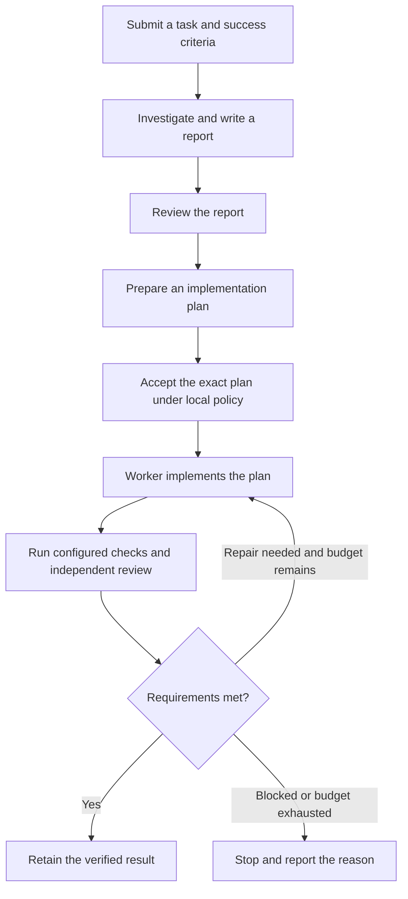
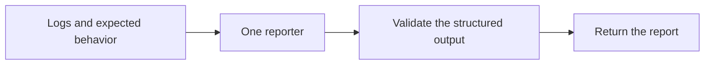

# Agent Engine

**Give coding agents a task, a plan and a clear finish line.**

Agent Engine runs on your machine and coordinates agents through investigation, planning, implementation and review. You choose which tools and models perform each role. The Engine tracks progress, runs configured checks and retains the results.

A coding agent or local application can submit a task once, then follow updates without repeatedly checking its status.

## How it works

A typical coding workflow looks like this. The selected flow determines which stages run.



Already have a plan? [Import it](docs/agent-quickstart.md#if-you-already-have-an-implementation-plan) when preparing the task. The Engine reviews its compatibility with the requirements and workspace before implementation.

Only need an analysis of logs or expected behavior? Use a simpler **report-only flow**:



Report-only flows do not launch a planner, repair worker or independent auditor. A completed report can describe a failure; it does not mean the underlying code has passed an audit.

## What you control

- **Agents and models:** configure the CLI, model and supported effort setting for each role.
- **Task scope:** specify success criteria, permitted changes and protected files.
- **Execution limits:** set time and repair budgets, permissions and approval policy.
- **Progress:** follow events in the CLI, a local application or the optional macOS HUD.
- **Results:** retain reports, plans, check results and review decisions under one task identity.

Repair changes belong on a dedicated branch or worktree in the target repository. The workflow does not automatically authorize merging or pushing them.

Agent Engine is a separate Go application. Agent Deck and OMA remain pinned, unmodified upstream dependencies; no maintained fork is required. See [upstream maintenance](docs/upstream-maintenance.md).

## Get started

### 1. Build the CLI

You need Git, Go 1.24 or later, and the provider CLIs you intend to use. Authenticate those tools separately.

From a clone of this repository:

```sh
cd agent-engine
./scripts/build-agent-engine.sh
./bin/agent-engine version --json
./bin/agent-engine capabilities --json
```

To put the executable on your PATH:

```sh
mkdir -p "$HOME/.local/bin"
install -m 0755 ./bin/agent-engine "$HOME/.local/bin/agent-engine"
export PATH="$HOME/.local/bin:$PATH"
```

Installation currently uses source builds. A published release installer is not yet available.

### 2. Configure your local deployment

The person managing the installation supplies:

- A **store directory** for task state and results, outside the repositories agents will edit.
- A **`CONTROL.toml` configuration** defining available flows, agent profiles, checks and limits.
- Authenticated provider tools, pinned runtimes and any required readiness evidence.
- Permission grants for workflows that allow agents to write files or run shell commands.

Start with [the setup guide](docs/trusted-local-caller-guide.md). Examples are available for [MiniMax with Codex review](examples/minimax-codex) and [Cursor report-only tasks](examples/cursor-report).

Use the absolute paths supplied for your installation:

```sh
export AGENT_ENGINE_BINARY=/absolute/path/to/agent-engine
export AGENT_ENGINE_STORE=/absolute/path/to/operator-store

"$AGENT_ENGINE_BINARY" --store "$AGENT_ENGINE_STORE" deployment-init --json
"$AGENT_ENGINE_BINARY" --store "$AGENT_ENGINE_STORE" flows --json
```

`flows --json` lists your configured workflows and their agent selections. Installing the binary alone does not configure or start a workflow.

### 3. Submit a task and follow progress

Follow the [coding-agent quickstart](docs/agent-quickstart.md) to **prepare → validate → launch** a task. In CLI commands, a task run is called an **episode**.

Keep the supervisor running. From a separate terminal, follow its updates:

```sh
"$AGENT_ENGINE_BINARY" --store "$AGENT_ENGINE_STORE" episode watch \
  --episode-id YOUR_EPISODE_ID --timeout 10m --events --json
```

Submit once and keep the episode ID and request file. Reconnect an observer using its saved cursor instead of repeatedly polling status. An observer timeout does not cancel the task.

If the task reaches `PLAN_ACCEPT`, it is waiting for acceptance of the exact plan under your local policy. Waiting for a decision is different from finishing successfully. Use `episode launch` to start execution; `episode drive` only advances stored state.

## Tools and models

Each configured profile selects a provider tool, model and supported effort level. Different roles can use different tools. Select an approved workflow to choose its profiles; requests cannot silently replace them with another executable or model.

The repository includes Agent Deck integration, MiniMax Code ACP support and a Cursor CLI report-only transport. The Cursor report example selects `composer-2.5`. Capabilities vary by transport, so a tool supported for reporting is not automatically supported for repair or independent review.

See [profile selection](docs/profile-selection.md) and [report-only setup](docs/report-only.md) for configuration and limitations.

### Spend reasoning where it matters

A useful starting configuration is a **powerful model for planning and independent review**, paired with **cheaper, efficient models for implementation**. Give workers a clear plan, bounded changes and explicit checks, then let the reviewer assess whether the result meets the requirements.

| Role | Suggested model allocation |
|---|---|
| Planner | A powerful reasoning model for architecture, dependencies and acceptance criteria |
| Worker | A cheaper, efficient coding model for well-scoped implementation and repairs |
| Independent reviewer | A powerful model in a separate session to assess evidence and completion |
| Simple reporter | A cheaper model when the input and required output are straightforward |

This can reduce model spend by reserving expensive reasoning for consequential decisions. A cheaper model does not necessarily use fewer tokens: repeated repairs or excessive context can erase the savings. Keep worker context focused, reuse the accepted plan and retained findings, and cap repair attempts. Use a stronger worker profile for complex tasks when needed; profile changes must follow the Engine's admission rules.

## Permissions

Agent Engine supervises the workflow; it does not automatically sandbox every agent's shell. A trusted-local worker runs with your user account's permissions and requires a local grant specifying the workspace, expiry and budgets. That grant is separate from plan acceptance.

Cursor report-only tasks use native `ask` mode in an empty temporary directory. This is not a proven operating-system sandbox, and that transport is not enabled for repair or independent approval.

## Optional macOS HUD

The floating HUD displays workflow progress. It is a separate companion built from this repository and requires macOS 13 or later plus Xcode command-line tools.

```sh
./scripts/build-agent-engine-hud.sh
mkdir -p "$HOME/Applications"
cp -R dist/AgentEngineHUD.app "$HOME/Applications/"
./bin/agent-engine hud start
```

Follow [the HUD setup guide](desktop/macos/AgentEngineHUD/README.md) to connect it to your local service. The HUD observes tasks; closing it does not cancel them.

## Documentation

| Guide | Purpose |
|---|---|
| [Coding-agent quickstart](docs/agent-quickstart.md) | Submit tasks, import plans and follow updates |
| [Local setup and application integration](docs/trusted-local-caller-guide.md) | Configure a deployment and connect callers |
| [Report-only workflows](docs/report-only.md) | Return structured analysis without a repair loop |
| [Profile selection](docs/profile-selection.md) | Choose tools, models and role settings |
| [Operations](docs/operations.md) | Run and troubleshoot the Engine |
| [Contracts](docs/contracts.md) | Understand task and result contracts |
| [Upstream maintenance](docs/upstream-maintenance.md) | Maintain pinned dependencies |

## Development

Read [AGENTS.md](AGENTS.md) before modifying the project.

```sh
go build ./...
go vet ./...
go test ./...
go test -race ./...
```

Ordinary tests use fixtures rather than paid model calls. Live acceptance tests require separate configuration. On macOS, run HUD fixtures with `sh scripts/test-agent-engine-hud-fixtures.sh`.

The executable and Go command directory are named `agent-engine`. This build writes state schema 7, which older executables refuse. Back up deployment state before upgrading. See [rename and upgrade notes](docs/rename-upgrade.md) when updating an existing installation.

Dated handovers describe past runs. Use the current quickstart and source for operating instructions; sample runs do not prove every deployment or integration.

## License

A project license has not yet been selected or included. Do not assume an open-source license from repository visibility.
